# ParaDefense

**GAS 기반 협동 TPS 디펜스 · 게임플레이 프로그래머 엄태호**

영웅과 스킬을 조합해 몰려오는 적으로부터 본진을 방어하는 부트캠프 팀 프로젝트입니다. 이 저장소에서는 제가 구현하거나 보완한 **스킬 획득, HUD 갱신, 원격 입력 전달, 전투 보조 시스템**을 중심으로 소개합니다.

[시연 영상 보기](https://naver.me/F6QuRipJ) · [개인 작업 브랜치](https://github.com/KimHelpMe/Project_GAS_TPSDefense/tree/Taehos260724) · [개인 커밋 기록](https://github.com/KimHelpMe/Project_GAS_TPSDefense/commits/Taehos260724/?author=KimHelpMe)

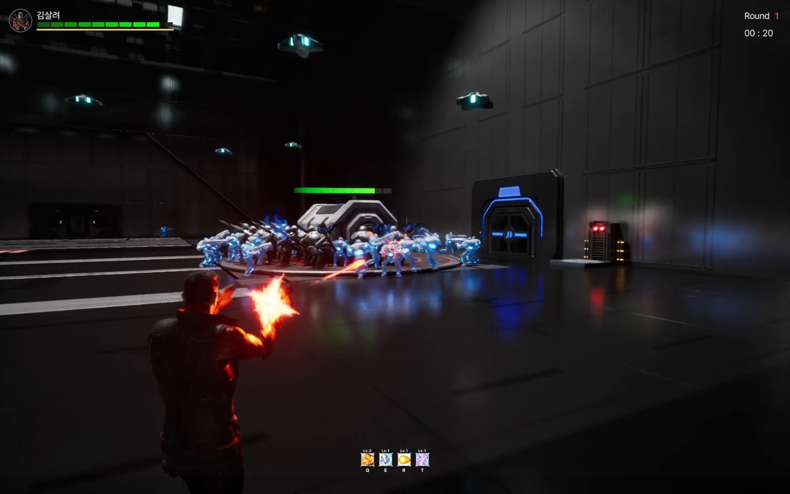

| 항목 | 내용 |
| --- | --- |
| 장르 | 협동 TPS 타워 디펜스 |
| 개발 형태 | 부트캠프 팀 프로젝트 |
| 개인 기능 개발 이력 | 2026.06–07 · Git 커밋 기준 |
| 엔진 / 언어 | Unreal Engine 5.7 / C++ · Blueprint |
| 플랫폼 | PC · Steam 온라인 서브시스템 연동 |
| 담당 | 엄태호 · [KimHelpMe](https://github.com/KimHelpMe) |

> **코드 열람 기준:** 포트폴리오의 구현과 수정 사항은 `Taehos260724` 브랜치에 있습니다. 아래 소스 링크도 해당 구현을 담은 커밋을 기준으로 연결했습니다.

## 개인 기여 범위

| 영역 | 직접 구현하거나 보완한 부분 |
| --- | --- |
| 스킬 획득 | 픽업의 능력 배정 정보 복제, 입력 슬롯 등록·조회, 조준 정보 표시 연결 |
| HUD | 능력 스펙 수신 후 슬롯 UI 알림, 본인·팀원 체력 갱신 알림 |
| 입력 / 전투 규칙 | Q/E/R/T에서 기존 서버 이벤트 RPC 호출 연결, 사망 대상의 추가 Health 감소 차단 |
| 전투 보조 | 회복 구역, 방어벽 생성·재사용 대기, 데이터 기반 라인별 웨이브 스폰 |
| 레벨 | 맵 배치와 적 이동 Spline 경로 자산 수정 |

GAS 기본 구조, 기존 레벨 변경 함수와 `MarkAbilitySpecDirty`, 서버 이벤트 RPC 수신 구현, 기본 전투·리스폰, 세션·로비는 **기존 팀 기반**입니다. 아래 설명에서는 이 기반에 추가한 개인 변경 범위를 구분했습니다.

## 게임 흐름

| 로비 | 웨이브 방어 | 스킬 획득 | 결과 |
| :---: | :---: | :---: | :---: |
| 영웅 선택·세션 합류 | 적 처치·본진 보호 | 슬롯 등록·레벨 증가 | 보스 처치·본진 파괴 |

## 1. 스킬 픽업과 입력 슬롯

조준한 픽업의 정보를 확인하고, 획득한 능력을 Q/E/R/T 입력 슬롯에 등록하는 기능입니다.

<table>
  <tr><th width="64%">픽업 조준</th><th width="36%">같은 장면의 정보창 확대</th></tr>
  <tr>
    <td>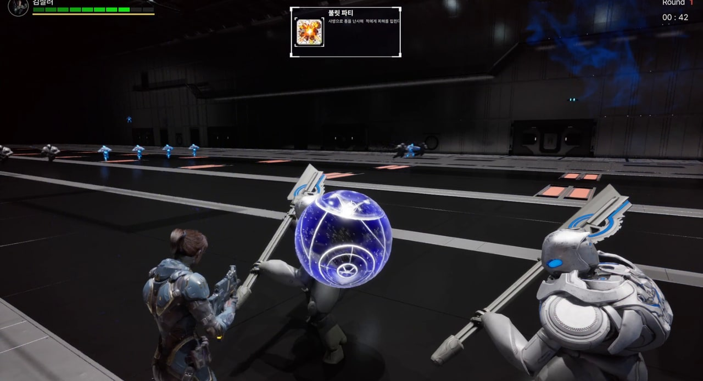</td>
    <td>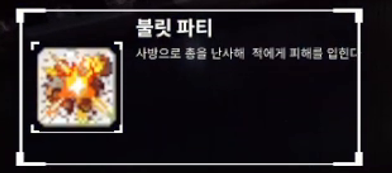</td>
  </tr>
</table>

서버가 생성 시 배정한 `AssignedAbility`를 복제하고, 팝업 표시와 실제 획득 처리에서 같은 값을 참조하도록 구성했습니다. 슬롯은 `SlotTag`, `Spec Handle`, `AbilityData`를 한 엔트리로 관리해 입력·실행·UI가 같은 능력을 식별하게 했습니다.

<table>
  <tr><th width="50%">획득 전</th><th width="50%">첫 능력 등록 후</th></tr>
  <tr>
    <td align="center"></td>
    <td align="center">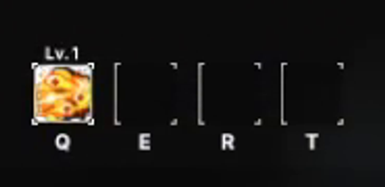</td>
  </tr>
</table>

**역할 분담:** `UCSAbilityData`는 능력 클래스·아이콘·설명을, `ACSAbilityPickup`은 서버 배정과 획득을, `UCSAbilitySystemComponent`는 슬롯과 부여한 능력의 상태를 관리합니다.

[픽업 배정·복제 코드](https://github.com/KimHelpMe/Project_GAS_TPSDefense/blob/e0c98c994ae1be8ee2ccf49fdfb374d59226d1d5/Source/GASBase/Private/Abilities/CSAbilityPickup.cpp) · [슬롯 등록·조회 코드](https://github.com/KimHelpMe/Project_GAS_TPSDefense/blob/e0c98c994ae1be8ee2ccf49fdfb374d59226d1d5/Source/GASBase/Private/AbilitySystem/CSAbilitySystemComponent.cpp) · [개인 구현 커밋 `c0733c3`](https://github.com/KimHelpMe/Project_GAS_TPSDefense/commit/c0733c35049f3dee617424b849141a0caaaf38a0)

## 2. 스킬 레벨 변경 후 슬롯 UI 갱신

<table>
  <tr><th width="50%">표시 상태 A · E Lv.1</th><th width="50%">표시 상태 B · E Lv.2</th></tr>
  <tr>
    <td>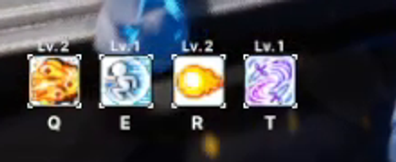</td>
    <td>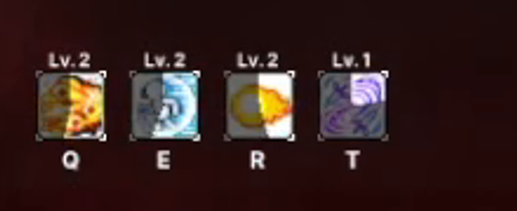</td>
  </tr>
</table>

<table>
  <tr><th width="12%">구분</th><th width="88%">내용</th></tr>
  <tr><td>문제</td><td>동일 스킬을 다시 획득하면 레벨은 증가하지만, 원격 클라이언트의 슬롯 레벨 표시 갱신이 누락됐습니다.</td></tr>
  <tr><td>원인</td><td>최초 획득은 <code>SlotToAbility</code>에 항목을 추가하지만, 재획득은 기존 <code>AbilitySpec.Level</code>을 변경합니다. 슬롯 할당 정보가 유지되면 슬롯 배열의 복제 알림만으로 레벨 변화를 처리할 수 없습니다.</td></tr>
  <tr><td>해결</td><td><code>OnRep_SlotToAbility()</code>뿐 아니라 <code>OnRep_ActivateAbilities()</code>에서도 같은 로컬 UI 이벤트를 알리도록 보완했습니다.</td></tr>
</table>

**CSAbilitySystemComponent.cpp · `OnRep_ActivateAbilities()`의 추가 구문**

```cpp
for (const FCSSlotAbilityEntry& Entry : SlotToAbility)
{
    OnSlotAbilityChanged.Broadcast(Entry.SlotTag, Entry.AbilityData);
}
```

개인 기여는 **슬롯 복제와 UI 알림 경로의 보완**입니다. 레벨 변경 함수와 `MarkAbilitySpecDirty`의 기본 처리는 팀 코드입니다. 위 이미지는 실제 HUD의 레벨 변화이며, 수정 전 버그를 재현한 비교 화면은 아닙니다.

[수정 코드](https://github.com/KimHelpMe/Project_GAS_TPSDefense/blob/e0c98c994ae1be8ee2ccf49fdfb374d59226d1d5/Source/GASBase/Private/AbilitySystem/CSAbilitySystemComponent.cpp#L26-L48) · [버그 수정 커밋 `a8d4fad`](https://github.com/KimHelpMe/Project_GAS_TPSDefense/commit/a8d4fad4e0e216419aaeaa4083a2a2bc2d49d4cd)

## 3. Ray 입력의 로컬·서버 이벤트 연결

<p align="center">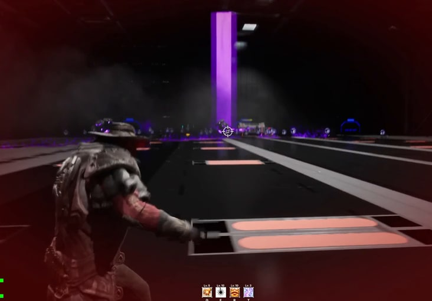</p>

원격 클라이언트에서 Ray 스킬의 키 입력이 누락되는 문제를 보완했습니다. **능력 활성화 요청**과 **GameplayEvent 전달**은 별도의 경로이므로, 로컬 Pawn에 보낸 이벤트가 서버 Pawn에도 자동으로 전달되는 것으로 처리할 수 없었습니다.

Q/E/R/T의 로컬 처리를 유지하면서, 비권한 클라이언트에서는 기존 `ServerSendGameplayEvent` RPC도 호출하도록 연결했습니다.

**CSPlayerController.cpp · `Q()`의 추가 구문**

```cpp
if (!HasAuthority())
{
    ServerSendGameplayEvent(CSGameplayTags::Input::Q);
}
```

RPC 수신 구현은 기존 팀 코드이며, **Q/E/R/T 입력 함수에서 호출을 연결한 부분**이 개인 기여입니다.

[Q/E/R/T 입력 코드](https://github.com/KimHelpMe/Project_GAS_TPSDefense/blob/e0c98c994ae1be8ee2ccf49fdfb374d59226d1d5/Source/GASBase/Private/Player/CSPlayerController.cpp#L215-L269) · [입력 수정 커밋 `7b5a53e`](https://github.com/KimHelpMe/Project_GAS_TPSDefense/commit/7b5a53ef121d3124d591e3a892fbb9210c37bfcd)

## 4. 본인·팀원 체력 HUD 갱신

<table>
  <tr><th width="50%">본인 체력</th><th width="50%">팀원 체력</th></tr>
  <tr>
    <td align="center" valign="middle">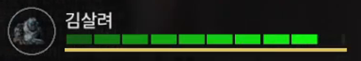</td>
    <td align="center">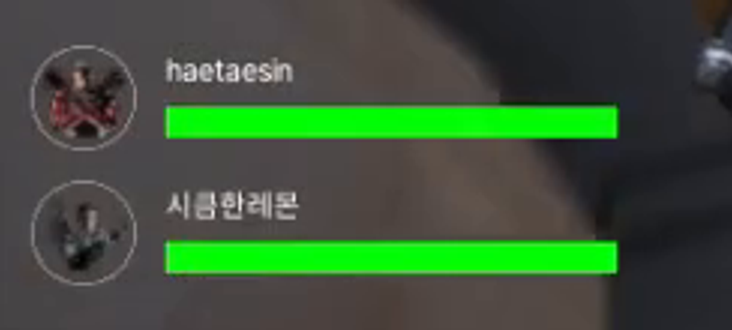</td>
  </tr>
</table>

호스트의 값 변경과 원격 클라이언트의 복제 수신 시점을 각각 UI 알림에 연결했습니다.

| 갱신 시점 | 연결 위치 |
| --- | --- |
| 서버에서 Health 처리 후 | `PostGameplayEffectExecute()`에서 값을 보정한 뒤 `OnHealthChanged` 호출 |
| 클라이언트에서 복제 수신 후 | `OnRep_Health()`와 `OnRep_MaxHealth()`에서 GAS 복제 알림과 UI 이벤트 처리 |

이미지는 실제 HUD 예시입니다. 호스트와 클라이언트의 동시 화면 검증 결과로 제시한 것은 아닙니다.

[체력 처리·복제 알림 코드](https://github.com/KimHelpMe/Project_GAS_TPSDefense/blob/e0c98c994ae1be8ee2ccf49fdfb374d59226d1d5/Source/GASBase/Private/AbilitySystem/CSAttributeSet.cpp) · [개인 변경 커밋 `323b42a`](https://github.com/KimHelpMe/Project_GAS_TPSDefense/commit/323b42a249dfa8444f426d712f7a1a5d43fc2afc)

## 5. 사망 대상의 추가 Health 감소 차단

<p align="center">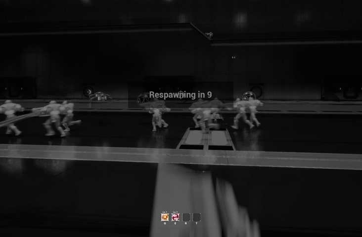</p>

개별 공격마다 사망 여부를 검사하는 대신, `PreGameplayEffectExecute()`에서 **Health 감소 효과가 사망 대상에게 적용되는지** 공통으로 판정하도록 추가했습니다.

- Health 속성의 음수 변화이며 대상이 사망 상태이면 해당 효과의 실행을 거부합니다.
- 양수 회복·초기화 효과는 이 조건으로 차단하지 않습니다.
- 적용 범위는 이 GameplayEffect 경로를 거치는 Health 감소입니다. 기본 사망·리스폰 시스템 전체를 개인 구현으로 분류하지 않습니다.

<details>
<summary>핵심 코드 보기 · CSAttributeSet.cpp / PreGameplayEffectExecute()</summary>

```cpp
if (Data.EvaluatedData.Attribute == GetHealthAttribute() &&
    Data.EvaluatedData.Magnitude < 0.f)
{
    const ACSBaseCharacter* TargetCharacter =
        Cast<ACSBaseCharacter>(Data.Target.GetAvatarActor());
    if (IsValid(TargetCharacter) && !TargetCharacter->IsAlive())
    {
        return false;
    }
}
```

</details>

화면은 사망 상태의 맥락이며, 특정 피해 효과의 거부 여부는 코드 조건을 근거로 설명했습니다.

[적용 전 판정 코드](https://github.com/KimHelpMe/Project_GAS_TPSDefense/blob/e0c98c994ae1be8ee2ccf49fdfb374d59226d1d5/Source/GASBase/Private/AbilitySystem/CSAttributeSet.cpp#L42-L61)

## 6. 회복 구역의 효과 적용과 해제

<table>
  <tr><th width="33%">진입 전</th><th width="34%">회복 중</th><th width="33%">구역 밖</th></tr>
  <tr>
    <td>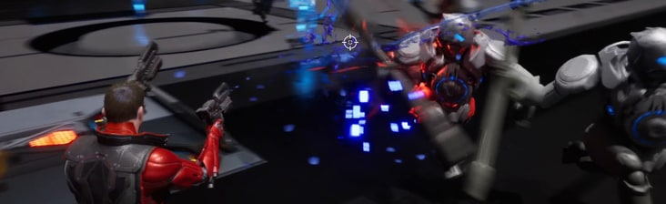</td>
    <td>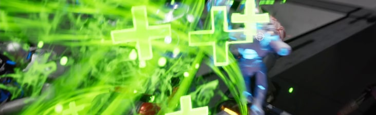</td>
    <td>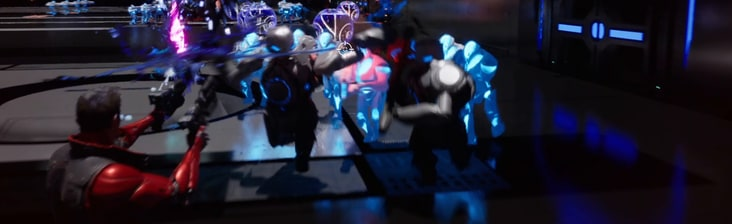</td>
  </tr>
</table>

서버에서 회복 GameplayEffect를 적용하고, 반환받은 `FActiveGameplayEffectHandle`을 캐릭터별로 저장했습니다. 구역을 벗어나면 저장한 핸들로 같은 효과를 제거하고, 구역의 `EndPlay()`에서도 남아 있는 효과를 정리합니다.

**설계 목적:** 적용한 효과와 제거할 효과를 핸들로 연결해, 캐릭터의 이탈과 구역 종료를 같은 수명 관리 안에서 처리하는 것입니다.

[회복 구역 코드](https://github.com/KimHelpMe/Project_GAS_TPSDefense/blob/e0c98c994ae1be8ee2ccf49fdfb374d59226d1d5/Source/GASBase/Private/GameObjects/CSHealingZone.cpp) · [구현 커밋 `ce4d2f2`](https://github.com/KimHelpMe/Project_GAS_TPSDefense/commit/ce4d2f2ffafed686df9512711bdef1aed9a5a8bc)

## 7. 방어벽 생성과 재사용 대기

<table>
  <tr><th width="33%">버튼 접근</th><th width="34%">방어벽 생성</th><th width="33%">전투 중 장벽</th></tr>
  <tr>
    <td>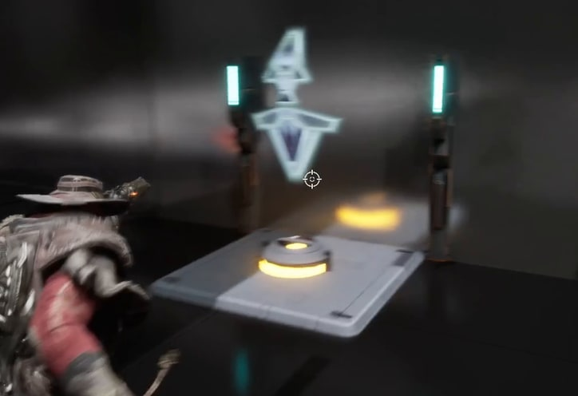</td>
    <td>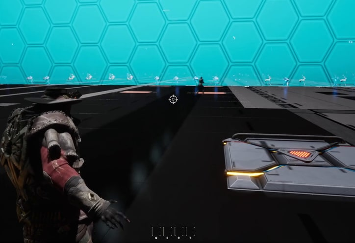</td>
    <td>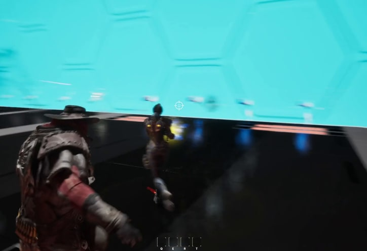</td>
  </tr>
</table>

| 객체 | 관리하는 상태 |
| --- | --- |
| `ACSWallSpawnButton` | 서버 권한·플레이어·쿨다운 검사, 벽 생성, 재사용 대기 타이머 |
| `ACSSpawnedWall` | 생성된 벽의 생존 시간과 소멸 처리 |

버튼의 재사용 대기와 벽의 수명을 나눠, 벽이 사라지는 시점과 버튼을 다시 사용할 수 있는 시점을 독립적으로 관리했습니다. 표시가 깜빡이는 프레임을 벽 소멸의 근거로 사용하지 않았으며, 두 시간의 분리는 코드 구조로 설명합니다.

[버튼 코드](https://github.com/KimHelpMe/Project_GAS_TPSDefense/blob/e0c98c994ae1be8ee2ccf49fdfb374d59226d1d5/Source/GASBase/Private/GameObjects/CSWallSpawnButton.cpp) · [생성된 벽 코드](https://github.com/KimHelpMe/Project_GAS_TPSDefense/blob/e0c98c994ae1be8ee2ccf49fdfb374d59226d1d5/Source/GASBase/Private/GameObjects/CSSpawnedWall.cpp)

## 8. 라인별 웨이브와 이동 경로

<p align="center">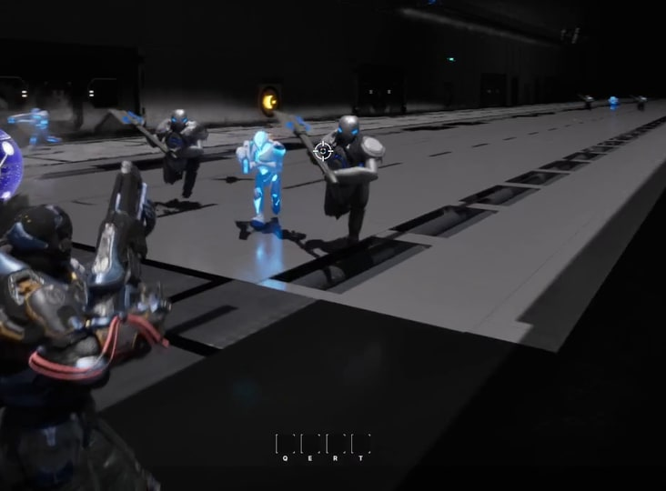</p>

DataTable에 라운드별 적 종류·수량·출현 간격·경로를 두고, 실행 중에는 라인별 `TimerHandle`과 `SpawnedCount`를 관리하도록 구성했습니다. 새 라운드를 시작할 때 기존 스폰 상태를 정리하고, 각 라인은 목표 수량에 도달하면 자신의 타이머를 종료합니다.

[스폰 컴포넌트](https://github.com/KimHelpMe/Project_GAS_TPSDefense/blob/e0c98c994ae1be8ee2ccf49fdfb374d59226d1d5/Source/GASBase/Private/Enemy/CSEnemySpawnerComponent.cpp) · [스폰 데이터 구조](https://github.com/KimHelpMe/Project_GAS_TPSDefense/blob/e0c98c994ae1be8ee2ccf49fdfb374d59226d1d5/Source/GASBase/Public/Data/CSEnemySpawnTableRow.h) · [개인 구현 커밋 `79decc3`](https://github.com/KimHelpMe/Project_GAS_TPSDefense/commit/79decc3dd65d431fb2a0310fade5de9e20cf2680)

### 맵 배치와 Spline 경로 작업

<table>
  <tr><th width="60%">레벨 편집기에서 본 경로</th><th width="40%">평면 배치</th></tr>
  <tr>
    <td>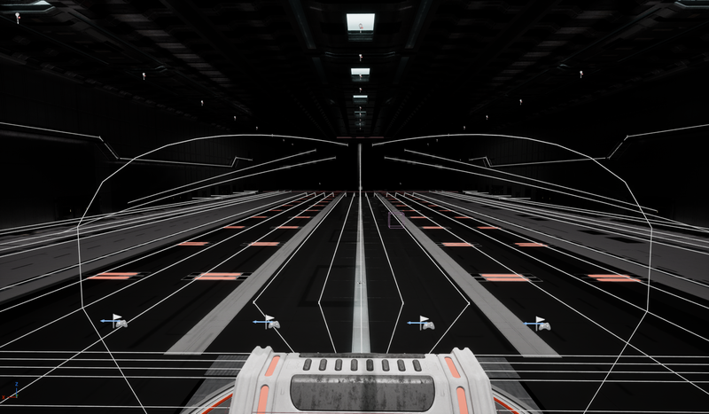</td>
    <td>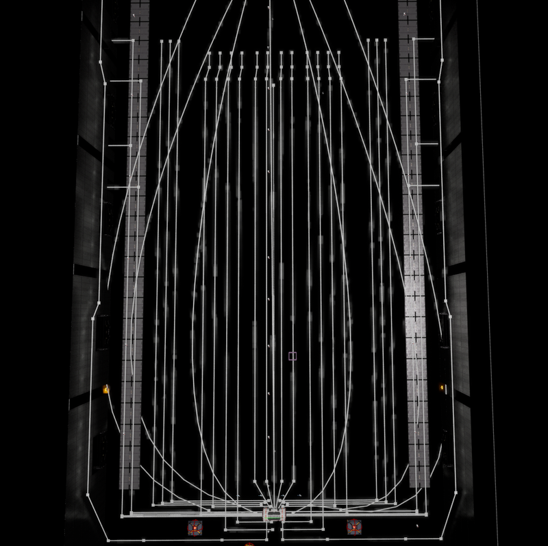</td>
  </tr>
</table>

맵 배치와 적 이동 Spline 경로 자산을 수정했습니다. 위 이미지는 최종 포트폴리오에 포함된 편집기 캡처이며, 전체 레벨의 단독 제작을 의미하지 않습니다.

## 적용 기술

| 기술 | 실제 사용 위치와 이유 |
| --- | --- |
| GAS / DataAsset | 능력의 콘텐츠 정보와 부여한 Spec Handle을 연결하고, 슬롯에서 실행 상태를 조회 |
| Replication / RepNotify | 픽업 배정 정보·능력 스펙·Health를 수신하는 위치에서 로컬 UI 갱신 |
| GameplayEvent / RPC | 원격 클라이언트의 입력 태그를 서버 Pawn의 이벤트 처리에 전달 |
| GameplayEffect | Health 감소의 적용 조건 판정, 회복 효과의 적용·해제 대상 식별 |
| DataTable / Timer | 라운드 설정과 라인별 반복 실행 상태, 방어벽 재사용 대기 분리 |

## 구현 시연

[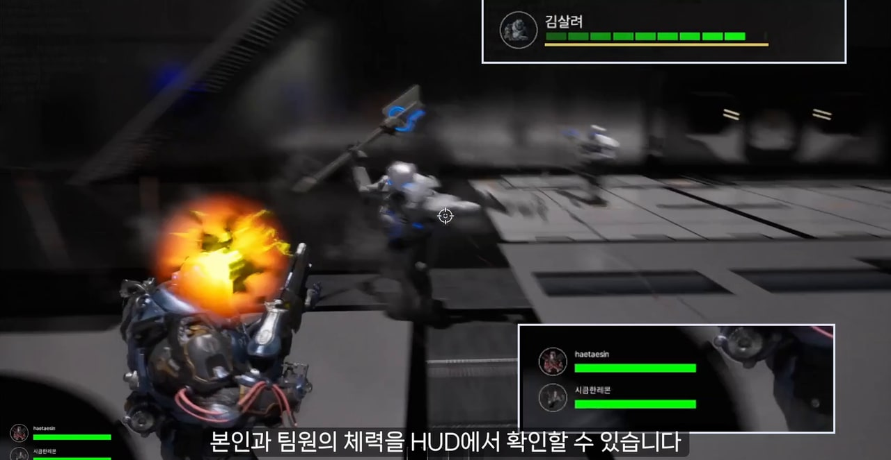](https://naver.me/F6QuRipJ)

[**시연 영상 열기**](https://naver.me/F6QuRipJ)

스킬 조준·획득, 레벨 표시, Ray, 체력 HUD, 회복 구역, 방어벽과 웨이브의 실제 동작을 담았습니다.

## 빌드 / 실행

포트폴리오에서 소개한 개인 구현을 확인하려면 다음 브랜치를 사용합니다.

```bash
git clone --branch Taehos260724 https://github.com/KimHelpMe/Project_GAS_TPSDefense.git
```

1. Unreal Engine **5.7**과 C++ 빌드 환경을 준비합니다.
2. `GASBase.uproject`에서 Visual Studio 프로젝트 파일을 생성합니다.
3. 생성한 솔루션에서 `Development Editor / Win64`로 빌드한 뒤 프로젝트를 엽니다.
4. Steam 연동 플레이를 확인할 때는 Steam 클라이언트를 실행합니다. 온라인 서브시스템과 세션 설정은 `Config/DefaultEngine.ini`, `Plugins/MultiplayerSessions`에 있습니다.

## 제작 정보

- **엄태호 / KimHelpMe** · 게임플레이 프로그래머
- **이메일:** [sssg2248@gmail.com](mailto:sssg2248@gmail.com)
- 이 문서의 개인 기여는 최종 포트폴리오와 해당 커밋의 변경 내용을 기준으로 정리했습니다.
- 게임 화면은 실제 플레이 영상, 경로 화면은 최종 포트폴리오의 레벨 편집기 캡처입니다.
- 캐릭터 등 일부 게임 에셋은 Epic Games의 Paragon 에셋을 사용했습니다.
